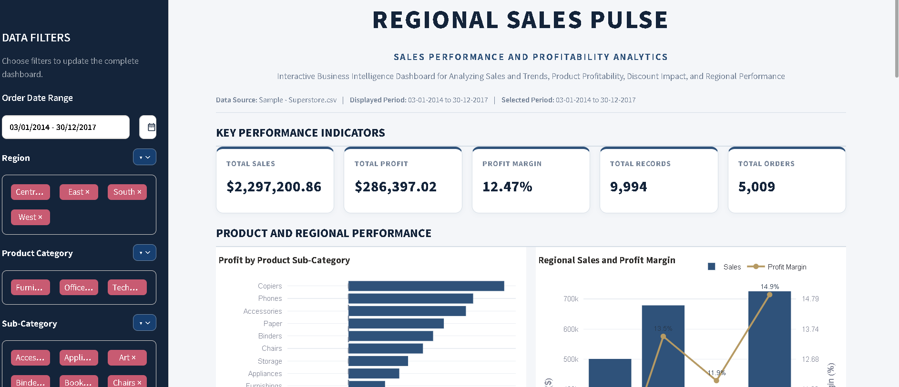
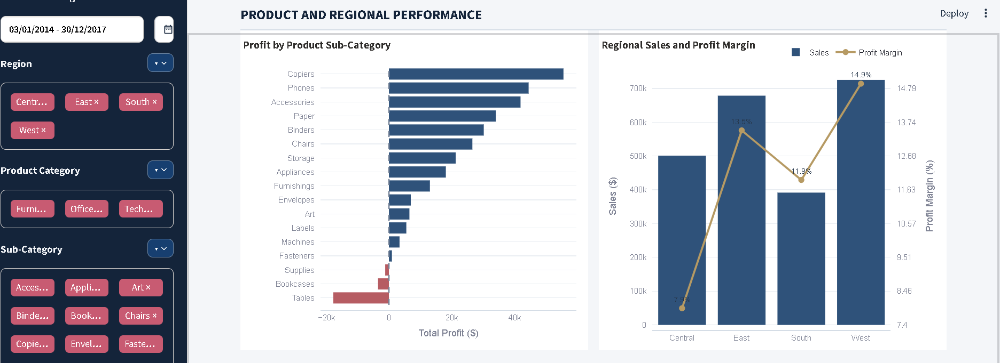
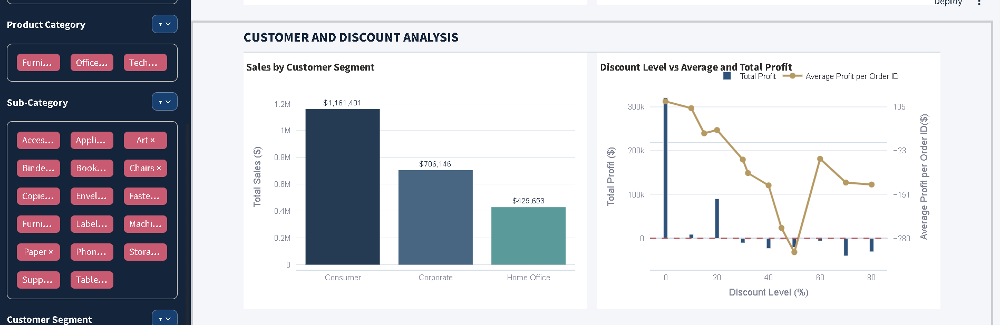
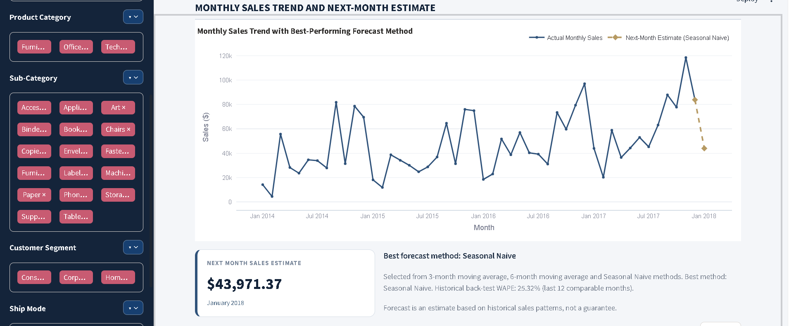
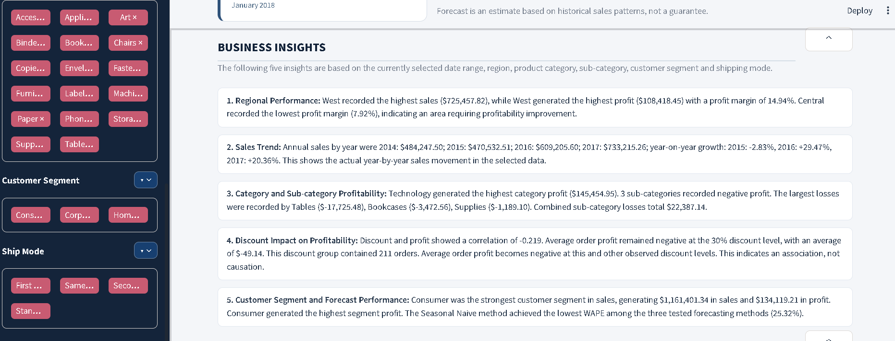
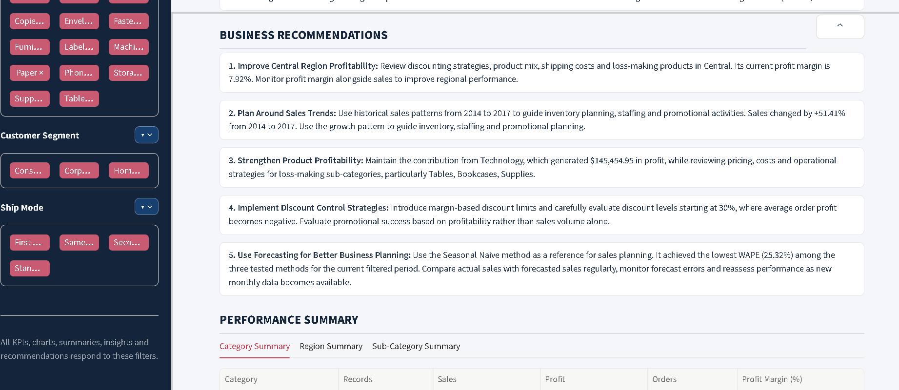
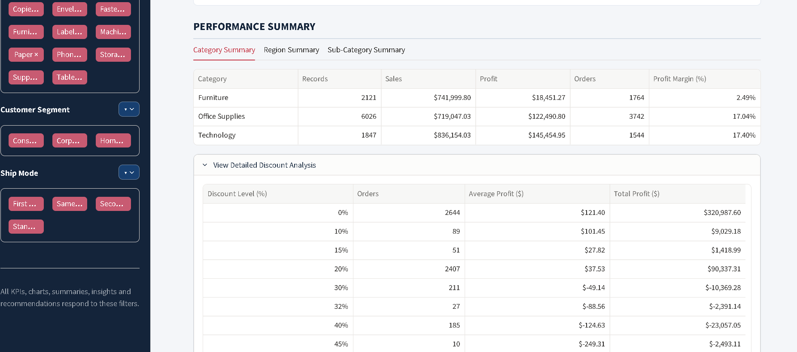

# Regional Sales Pulse
### Interactive Sales Performance & Profitability Dashboard

A Streamlit-based business intelligence dashboard built to analyze sales performance, profitability, regional trends, product performance, discount impact, and sales forecasting using the Sample Superstore dataset.

---

## Project Overview

Regional Sales Pulse is designed to help a regional sales manager understand not only how much the business sells, but also how much profit it generates and where profitability needs attention.

The dashboard provides interactive filters and dynamically updates its KPIs, charts, business insights, and recommendations based on the selected data. It supports business decisions related to regional performance, product profitability, discount control, and future sales planning.

**Target roles:** Data Analyst | Business Analyst

## Business Problem

The project is based on the business request in the project brief:

> Sales have increased, but management needs to understand which products, regions, and discount levels are affecting profit, and what actions can improve business performance. The manager needs an interactive dashboard that can be filtered and reviewed regularly.

The dashboard addresses this request by analyzing sales and profit across time, region, product category, sub-category, customer segment, and shipping mode.

## Business Questions

This project answers the following questions:

1. Which product sub-categories are generating losses, and how much profit is being lost?
2. At which discount levels does the average order profit become negative?
3. Which region generates the highest sales, and which region has the lowest profit margin?
4. How do sales and profit change month by month and year by year?
5. Which product categories, customer segments, and regions contribute most to business performance?

## Dataset

- **Dataset:** Sample Superstore
- **Records:** 9,994 rows
- **Columns:** 24
- **Unique orders:** 5,009
- **Order date range:** 03 January 2014 – 30 December 2017
- **Geography:** United States retail sales

The dataset includes order dates, shipping details, customer segments, regions, product categories, sub-categories, sales, discounts, quantities, and profit.

> The analysis uses the supplied Sample Superstore dataset. The figures below describe the complete dataset with no restrictive dashboard filters selected.

## Tools & Technologies

- **Python** – analysis and application logic
- **Pandas** – data cleaning, transformation, and aggregation
- **NumPy** – numerical calculations
- **Plotly** – interactive charts
- **Streamlit** – interactive dashboard application
- **Excel** – independent verification using PivotTables
- **Jupyter Notebook** – exploratory analysis and forecasting evaluation
- **Git & GitHub** – version control and project publishing
## Dashboard Screenshots

### 01. Dashboard Overview


### 02. Dashboard View


### 03. Dashboard View


### 04. Dashboard View


### 05. Dashboard View


### 06. Dashboard View


### 07. Dashboard View

## Dashboard Features

### 1. Interactive Filters

The dashboard includes filters for:

- Order date range
- Region
- Product category
- Product sub-category
- Customer segment
- Shipping mode

The KPI cards, charts, tables, business insights, and recommendations respond to the active filter selections. The insight and recommendation text is generated from the filtered data rather than being fixed statements.

### 2. Key Performance Indicators

The dashboard displays five headline metrics:

- **Total Records**
- **Total Sales**
- **Total Profit**
- **Profit Margin (%)**
- **Total Orders**

Profit margin is calculated as:

`Profit Margin = (Total Profit / Total Sales) × 100`

The number of orders is calculated using distinct Order IDs, not the number of rows.

### 3. Visual Analysis

The dashboard includes the following business charts and analysis:

- Monthly Sales Trend
- Sales and Profit by Region
- Sales by Customer Segment
- Profit by Product Category
- Top 5 and Bottom 5 Sub-Categories
- Sales vs. Profit by Sub-Category
- Discount impact on profitability
- Monthly sales forecasting comparison and forecast view

Each chart is intended to answer a different business question and avoid unnecessary repetition.

### 4. Dynamic Business Insights

The dashboard presents five business insights based on the currently selected filters:

1. Regional Performance
2. Annual Sales Trend
3. Category and Sub-Category Profitability
4. Discount Impact on Profitability
5. Customer Segment and Forecast Performance

Each insight is supported by calculated values from the active selection. Changing the filters updates the relevant findings.

### 5. Dynamic Business Recommendations

The dashboard presents five recommendations based on the filtered business results:

1. Improve Regional Profitability
2. Plan Around Sales Trends
3. Strengthen Product Profitability
4. Implement Discount Control Strategies
5. Use Forecasting for Better Business Planning

These recommendations are linked to the findings in the selected data. They are intended as decision-support suggestions, not automatic business decisions.

## Key Findings

The following findings are based on the full dataset.

### 1. Regional Performance

| Region | Sales | Profit | Profit Margin |
|---|---:|---:|---:|
| West | $725,457.82 | $108,418.45 | 14.94% |
| East | $678,781.24 | $91,522.78 | 13.48% |
| Central | $501,239.89 | $39,706.36 | 7.92% |
| South | $391,721.91 | $46,749.43 | 11.93% |

- West generated the highest sales and highest total profit.
- Central recorded the lowest profit margin at 7.92%.
- The region with the highest sales is not the region with the lowest margin: West leads in sales, while Central has the lowest margin.

### 2. Annual Sales Trend

| Year | Total Sales | Year-over-Year Growth |
|---|---:|---:|
| 2014 | $484,247.50 | — |
| 2015 | $470,532.51 | -2.83% |
| 2016 | $609,205.60 | +29.47% |
| 2017 | $733,215.26 | +20.36% |

Sales declined slightly in 2015 and increased in both 2016 and 2017. Total annual sales grew by approximately 51.41% between 2014 and 2017.

### 3. Category Profitability

| Category | Sales | Profit | Profit Margin |
|---|---:|---:|---:|
| Technology | $836,154.03 | $145,454.95 | 17.40% |
| Office Supplies | $719,047.03 | $122,490.80 | 17.04% |
| Furniture | $741,999.80 | $18,451.27 | 2.49% |

Technology generated the highest sales and profit. Furniture had a much lower profit margin than the other two categories, despite generating substantial sales.

### 4. Loss-Making Sub-Categories

| Sub-Category | Sales | Profit |
|---|---:|---:|
| Tables | $206,965.53 | -$17,725.48 |
| Bookcases | $114,880.00 | -$3,472.56 |
| Supplies | $46,673.54 | -$1,189.10 |

Three sub-categories recorded negative total profit. Tables had the largest loss, at $17,725.48. The combined loss across these three sub-categories was $22,387.14.

### 5. Discount Impact on Profitability

- The correlation between discount and profit at the transaction level was approximately **-0.219**.
- At a 30% discount, the average order profit was **-$49.14** across **211 orders**.
- Average order profit was also negative at some higher observed discount levels.

This indicates an association between discounting and lower profitability in this dataset. Correlation does not prove that discounts alone caused the losses; product mix, order size, and other factors may also affect profit.

### 6. Customer Segment Performance

| Segment | Sales | Profit |
|---|---:|---:|
| Consumer | $1,161,401.34 | $134,119.21 |
| Corporate | $706,146.37 | $91,979.13 |
| Home Office | $429,653.15 | $60,298.68 |

Consumer was the largest segment by both sales and total profit.

### 7. Monthly Sales Trend

- Highest monthly sales: **November 2017 – $118,447.83**
- Lowest monthly sales: **February 2014 – $4,519.89**

Monthly results help identify periods of stronger and weaker sales activity and support seasonal planning.

## Business Recommendations

Based on the full-dataset findings, the following actions are recommended:

1. **Improve Central Region Profitability:** Review discounting, product mix, shipping costs, and loss-making orders in Central, where the profit margin is 7.92%. Monitor margin alongside sales rather than focusing on revenue alone.
2. **Plan Around Sales Trends:** Use the monthly and annual sales patterns to support inventory, staffing, and promotional planning. Pay attention to stronger sales periods while checking whether profit grows at a similar rate.
3. **Strengthen Product Profitability:** Review pricing, costs, and operational factors for Tables, Bookcases, and Supplies, which recorded negative profit. Protect the strong contribution from Technology while monitoring category margins.
4. **Apply Discount Controls:** Introduce margin-based discount limits and review orders receiving discounts of 30% or more carefully. Evaluate promotions using profit as well as sales volume.
5. **Use Forecasting Carefully:** Use the best-performing tested forecasting method as a planning reference, compare forecasts with actual sales, and update the approach as new monthly data becomes available.

These are recommendations for investigation and management review. The analysis identifies patterns and associations; it does not establish causation.

## Sales Forecasting

A simple next-month sales forecast was included as a stretch feature in the project.

Three methods were compared:

- 3-Month Moving Average
- 6-Month Moving Average
- Seasonal Naive Forecast

The models were evaluated using Weighted Absolute Percentage Error (WAPE) on a historical back-test.

| Forecasting Method | WAPE |
|---|---:|
| Seasonal Naive | 25.32% |
| 3-Month Moving Average | 30.75% |
| 6-Month Moving Average | 34.60% |

The **Seasonal Naive** method achieved the lowest WAPE among the three tested methods. Its forecast is used as a reference, not a guarantee. Forecast reliability is limited by the short historical period, possible seasonal variation, and the fact that future business conditions may differ from the past.

## What I Verified and What I Changed by Hand

### Excel Verification

I independently checked the dashboard's sales and profit aggregations in Excel using PivotTables. The checks covered:

- Region-wise sales and profit
- Category-wise sales and profit
- Sub-category-wise sales and profit
- Monthly sales and profit

The category PivotTable check required by the project brief is included below. These are the expected full-dataset totals displayed by the dashboard.

**Category-wise Excel verification reference**

| Category | Excel PivotTable Sales | Excel PivotTable Profit |
|---|---:|---:|
| Furniture | $741,999.80 | $18,451.27 |
| Office Supplies | $719,047.03 | $122,490.80 |
| Technology | $836,154.03 | $145,454.95 |

**Additional cross-check figures**

- West region sales: **$725,457.82**; profit: **$108,418.45**
- Central region sales: **$501,239.89**; profit: **$39,706.36**
- Tables sales: **$206,965.53**; profit: **-$17,725.48**
- November 2017 sales: **$118,447.83**; profit: **$9,690.10**

The figures above are shown to make the independent checks transparent and reproducible. The same aggregation fields and filters should be used in Excel and the dashboard when comparing results.

### What I Improved Manually

- Built a professional executive-style dashboard using a navy, steel, platinum, and gold color palette.
- Organized the analysis into distinct charts so that each visualization serves a separate business purpose.
- Added interactive filters for date range, region, category, sub-category, customer segment, and shipping mode.
- Made the business insights and recommendations respond to the active filter selections.
- Added a comparison of three simple forecasting methods and reported their back-test errors rather than presenting a forecast without an accuracy check.

## How to Run the Project

Follow these steps to download the **Regional-Sales-Pulse** repository and run the dashboard on a Windows computer.

### Step 1: Install the Prerequisites

Make sure the following applications are installed:

- **Python 3.10 or later** – to run the Python application.
- **Visual Studio Code (VS Code)** – to open the project and use its integrated terminal.
- **Git** – required only if you want to clone the repository using the Git command.

### Step 2: Download the Project from GitHub

Open the project repository:

[Regional-Sales-Pulse – GitHub Repository](https://github.com/punyapradeep2004/Regional-Sales-Pulse)

To download the project without using Git:

1. Open the repository link above.
2. Click the green **Code** button.
3. Select **Download ZIP**.
4. Open your Downloads folder.
5. Right-click the downloaded ZIP file and select **Extract All**.
6. Open the extracted **Regional-Sales-Pulse** folder.

Alternatively, if Git is installed, open PowerShell or the VS Code terminal and run:

```bash
git clone https://github.com/punyapradeep2004/Regional-Sales-Pulse.git
```

### Step 3: Open the Project Folder in VS Code

1. Open Visual Studio Code.
2. Select **File → Open Folder**.
3. Browse to the extracted or cloned **Regional-Sales-Pulse** folder.
4. Select the folder and click **Select Folder**.

Make sure you open the project folder itself, not just the `APP.py` file.

### Step 4: Open the Correct Terminal

In VS Code, use the top menu:

**Terminal → New Terminal**

A terminal panel will appear at the bottom of the VS Code window. On Windows, it will usually open **PowerShell**. You can use this terminal to enter the commands below.

Check that the terminal is currently inside the `Regional-Sales-Pulse` project folder. If it is not, change to that folder using the `cd` command. For example:

```powershell
cd "C:\Users\YourUserName\Downloads\Regional-Sales-Pulse"
```

Replace the example path with the actual location of your extracted project folder.

### Step 5: Create and Activate a Virtual Environment

In the VS Code terminal, run:

```powershell
python -m venv venv
```

Activate the environment in Windows PowerShell:

```powershell
.\venv\Scripts\Activate.ps1
```

If you are using Command Prompt instead of PowerShell, activate it with:

```cmd
venv\Scripts\activate.bat
```

### Step 6: Install the Project Dependencies

Make sure the terminal is in the project folder and the virtual environment is activated. Then run:

```bash
python -m pip install --upgrade pip
pip install -r requirements.txt
```

### Step 7: Run the Dashboard

Start the Streamlit application using:

```bash
streamlit run APP.py
```

Streamlit will display a local URL in the terminal, usually:

```text
http://localhost:8501
```

Open that address in your web browser to use the **Regional Sales Pulse** dashboard. Keep the terminal running while you use the dashboard. To stop the application, return to the terminal and press `Ctrl + C`.

**Note:** Keep `Sample - Superstore.csv` in the location expected by `APP.py`. The application file and dataset must both be available for the dashboard to load successfully.

## Requirements

Create a `requirements.txt` file containing:

```text
streamlit
pandas
numpy
plotly
```

## Suggested Project Structure

```text
Regional-Sales-Pulse/
│
├── APP.py
├── Sample - Superstore.csv
├── requirements.txt
├── README.md
└── dashboard_screenshot.png
```

## Conclusion

Regional Sales Pulse transforms raw retail sales data into an interactive business analysis tool. It combines data preparation, exploratory analysis, KPI tracking, visualization, profitability analysis, Excel verification, dynamic insights, actionable recommendations, and basic forecasting.

The project demonstrates how a Data Analyst can move beyond reporting sales totals to identify profitability issues, explain business patterns with numerical evidence, and support better decisions through an interactive dashboard.
